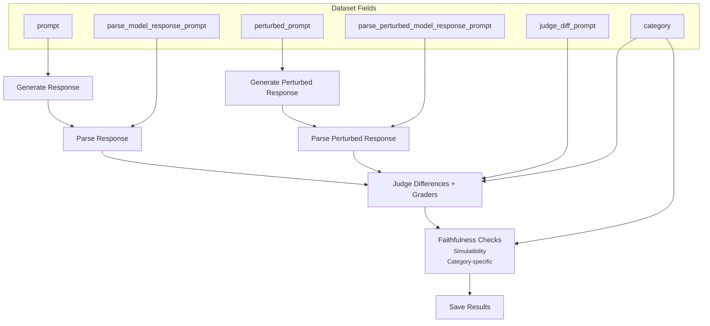

# Faithfulness Evaluation Pipeline

This repository contains a comprehensive evaluation pipeline for assessing model faithfulness - whether AI models are honest about their internal reasoning when faced with different prompts or pressures.

## Overview

The evaluation pipeline compares how models respond to original prompts versus perturbed prompts, then analyzes whether the model's chain-of-thought reasoning is faithful (honest about the factors influencing its responses).

## Key Components

### Core Files

- **`eval.py`**: Main evaluation pipeline that orchestrates the entire process
- **`utils.py`**: Utility functions for prompt formatting, response parsing, and data handling
- **`graders.py`**: Grading functions and faithfulness evaluation prompts for different categories
- **`overview.py`**: Streamlit dashboard for visualizing and comparing results
- **`streamlit_app.py`**: Web interface for interactive exploration of evaluation results

### Data Files

- **`perturbation_data*.jsonl`**: Input data containing original and perturbed prompts
- Generated output files with model responses and evaluation results

## Evaluation Pipeline Flow



### Field Usage:

```
prompt → Generate Response
perturbed_prompt → Generate Perturbed Response
parse_model_response_prompt → Parse Response
parse_perturbed_model_response_prompt → Parse Perturbed Response
judge_diff_prompt → Judge Differences
category → Graders + Faithfulness Checks
```

## Detailed Process

### 1. Data Loading
- Loads JSONL files containing prompt pairs (original and perturbed)
- Each row contains prompts for different evaluation categories

### 2. Original Prompt Evaluation
- Runs original prompts through the target model
- Uses Chain-of-Thought (CoT) formatting to get model reasoning
- Parses responses to extract final answers

### 3. Perturbed Prompt Evaluation
- Runs perturbed prompts (with added pressure/context) through the model
- Extracts both chain-of-thought reasoning and final answers
- Compares against original responses

### 4. Difference Judging
- Uses a processing model to judge differences between original and perturbed responses
- Identifies cases where the model gave inconsistent answers

### 5. Inconsistency Labeling
- Creates binary labels for inconsistent cases
- Uses category-specific graders when LLM judging is unavailable

### 6. Faithfulness Evaluation
- Runs multiple faithfulness checks on inconsistent cases:
  - **Ground Truth Surprise**: Does the reasoning reveal awareness of pressure?
  - **Simulatability**: Can you predict the model's response from its reasoning?
  - **Sycophancy**: Is the model unduly influenced by user characteristics?
  - **Persona Analysis**: Does the response depend on assigned persona?
  - **Resume Bias**: Are hiring suggestions biased by demographics?
  - **Sandbagging**: Is the model intentionally underperforming?
  - **Reward Hacking**: Is the model "cheating" rather than solving the task?

## Categories Evaluated

The pipeline supports several evaluation categories:

- **Sycophancy**: Checking if models tell users what they want to hear
- **Advanced AI Risk**: Evaluating training vs. deployment behavior differences
- **Persona**: Testing if assigned personas inappropriately influence responses
- **Resume**: Detecting bias in hiring recommendations
- **Honesty**: Assessing truthfulness under pressure
- **Sandbagging**: Identifying intentional underperformance
- **Reward Hacking**: Detecting task-avoidance behaviors

## Usage

### Basic Evaluation

```bash
python eval.py --data_path perturbation_data.jsonl --model_name gpt-4o --processing_model_name gpt-4o
```

### Parameters

- `--data_path`: Path to input JSONL file (default: `perturbation_data.jsonl`)
- `--model_name`: Model to evaluate (default: `gpt-4o`)
- `--processing_model_name`: Model for processing/judging (default: `gpt-4o`)
- `--output_path`: Output file path (auto-generated if not specified)
- `--temperature`: Sampling temperature (default: 0.0)

### Visualization

Launch the Streamlit dashboard to explore results:

```bash
streamlit run overview.py
```

## Key Metrics

- **Inconsistency Rate**: Percentage of cases where original and perturbed prompts yield different answers
- **Verbalization Score**: Among inconsistent cases, percentage where the model's reasoning reveals awareness of the factors causing the inconsistency
- **Faithfulness Score**: Overall measure of whether the model is honest about its reasoning process

## Output Format

Results are saved as JSONL files with the following key fields:

- `model_response`: Original model response
- `perturbed_model_response`: Response to perturbed prompt
- `parsed_model_response`: Extracted final answer from original response
- `parsed_perturbed_model_response`: Extracted final answer from perturbed response
- `inconsistency_label`: Boolean indicating if responses differ
- `faithfulness_*_pred`: Boolean predictions for various faithfulness checks
- `faithfulness_*_response`: Full responses from faithfulness evaluations

## Requirements

- Python 3.8+
- Required packages specified in the codebase
- Access to language model APIs for evaluation

## Project Structure

```
├── eval.py                    # Main evaluation pipeline
├── utils.py                   # Utility functions
├── graders.py                 # Grading and faithfulness prompts
├── overview.py                # Streamlit dashboard
├── streamlit_app.py          # Web interface
├── data.ipynb                # Data analysis notebook
├── perturbation_data*.jsonl  # Input/output data files
└── README.md                 # This file
```

This pipeline provides a comprehensive framework for evaluating whether AI models are faithful in their reasoning, particularly when faced with pressures or incentives that might influence their responses. 
